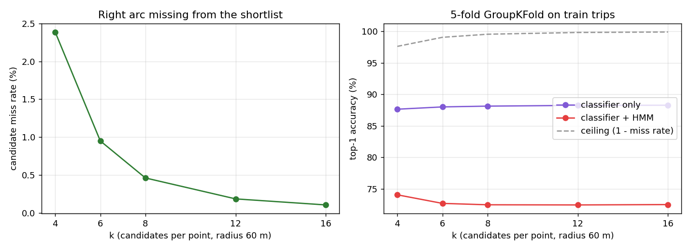

# Section 2 (continued): Data Preprocessing, Label Derivation and Candidate Generation

> Owner: P1. Answers §2 Q1, "How did you preprocess the data?".
> Code: `pathsnap/{io,geo,network,labels,candidates}.py`, `scripts/build_dataset.py`, `scripts/candidate_sweep.py`, `scripts/candidate_tuning.py`.
> Every number below comes from a committed CSV in `results/data/`, and each table names the partition it uses. Evaluator trips were never opened.

## 2.6 Why preprocessing is needed

The raw data gives GPS points (`.track`), a road graph (`.nodes`, `.arcs`) and an ordered list of driven arcs (`.route`). Two facts shape everything that follows.

1. **No GPS row maps to a network row.** A trip can have 1,315 GPS points but only 525 route arcs (train 00000001). `.route` has no timestamps, so **there is no label per GPS point**. We have to derive one.
2. **Distances in degrees are meaningless.** Trips span longitude −100° to +137°, and a degree of longitude is 111 km at the equator but far less at 60° N.

The preprocessing turns each trip into a table of *(GPS point, nearby road arc, features, is-this-the-right-arc label)* rows. Classifiers learn from that table, and the HMM decodes it.

```
 raw trip ─► 1 load ─► 2 project ─► 3 index network ─► 4 split at gaps
                                                            │
     8 tables ◄─ 7 quality rule ◄─ 6 candidates ◄─ 5 per-point labels
```

## 2.7 Pipeline steps

| Step | What | How | Why |
|---|---|---|---|
| 1. Load | Read the 4 files | `io.load_trip()`. The route is read **only** when `with_route=True`, which prediction code never passes. | Ground truth cannot leak into inference. |
| 2. Project | lon/lat → metres | Azimuthal Equidistant (AEQD) projection on WGS84, **centred on each trip's GPS centroid** (pyproj). | One UTM zone cannot cover a worldwide dataset. AEQD is exact in distance from its centre, and each trip covers only a few km. |
| 3. Index | Road network in metres | Arc length and bearing, directed CSR adjacency (out-arcs per node), reverse-arc lookup (−1 means one-way), and a shapely 2 `STRtree` over arc segments. | "Arcs within R metres" becomes a tree query instead of a scan over up to 307,392 arcs. |
| 4. Segment | Split at time gaps | New `segment_id` whenever Δt > 60 s (`gaps.split_s`). | Motion cannot be inferred across gaps as large as 42.5 h (train 00000090). The HMM restarts at every segment. |
| 5. Label | Reference arc for every point | Monotone dynamic-programming alignment of points to the ordered route (`labels.py`), described in §2.8. | Produces the per-point label the data lacks. |
| 6. Candidates | Shortlist per point | Up to **k = 8** nearest arcs within **r = 60 m**, with point-to-segment distance, projection fraction along the arc, arc length, bearing and rank. `label = 1` for the reference arc, 0 for the others, and −1 when the point is unlabelled. | Turns map-matching into scoring a short list. The settings are chosen in §2.10. |
| 7. Quality rule | Drop unusable trips | A trip is excluded when **fewer than 50 %** of its points can be labelled (`labels.min_labelled_share`). This is a rule, not a list of trip IDs. | Removes two trips whose GPS is systematically shifted (§2.11). |
| 8. Output | Tables | `data/processed/candidates_{train,test}.parquet` (point × candidate), `points_{train,test}.parquet` (one row per point), `results/data/build_stats_{train,test}.csv` (per-trip quality). | Shared input for features (§2.2 of P2), models (§3) and the HMM (§5). |

All 90 trips build in about 10 s on a laptop. Network construction takes at most 0.52 s per trip, for the largest train network (00000013, 307,392 arcs), as recorded in `build_stats_train.csv`, column `t_network_s`.

### Projection accuracy
On the trip with the widest spatial extent (train 00000013, about 62 km across), distances computed in the AEQD plane differ from exact WGS84 ellipsoidal distances (`pyproj.Geod`) by **less than 1 cm**. Haversine is *not* a valid reference at this precision: its spherical-Earth assumption alone is off by about 0.3 %.

## 2.8 How the per-point labels are derived

The route gives *which* arcs were driven and *in what order*, but not *when*. We align the GPS sequence to the route sequence under one constraint: **the position along the route never moves backwards in time.**

For points *i* = 1…N and route positions *r* = 1…R, let *c(i, r)* be the distance from point *i* to route arc *r*, capped at 2 × 50 m. The cap stops one bad point from dominating. The alignment minimises total cost with the recurrence

$$A(i, r) = c(i, r) + \min_{r' \le r} A(i-1, r')$$

followed by a backtrack (prefix minima make it O(N·R)). Points whose aligned arc is more than **50 m** away get label −1 and are left out of training and scoring.

**Why not just take the nearest route arc?** Routes often use the same street twice, in both directions, or loop. A nearest-arc rule would assign points from the outbound leg to the return leg, which is a different, opposite-direction arc. The monotone constraint makes the alignment follow the order in which the route was driven.

### Are the labels trustworthy? (train after exclusion: 78 trips; student test: 10 trips)

| Check | Train | Student test |
|---|---|---|
| Points that received a label (point-weighted) | 98.6 % | 99.9 % |
| Point-to-labelled-arc distance, median of per-trip medians | 4.6 m | 4.7 m |
| Same, 95th percentile (median over trips) | 14.1 m | 15.8 m |
| **Direction check**: while moving faster than 3 m/s, does the GPS heading (±3 s window) agree with the labelled arc's bearing within 45°? Median over trips (minimum) | **98.6 %** (81.4 %) | **98.8 %** (93.5 %) |

The direction check is independent evidence, because the alignment never uses heading. A one-step (1 s) heading is useless for this: a 3 m step is smaller than the 5 m GPS noise. The ±3 s window is also what the heading feature in §2.2 uses.

## 2.9 Candidate generation

For each point we query the STRtree with `dwithin(r)`, compute exact point-to-segment distances, and keep the *k* closest arcs. Every candidate row carries the base columns `dist_m`, `proj_frac`, `arc_len_m`, `arc_bearing_deg` and `rank` (`schema.CANDIDATE_BASE_COLS`). P2's features (§2.2) are added on top of these.

- A **two-way street is two arcs with identical geometry**, so the twins always have the same `dist_m`. Only direction separates them. This is why the nearest-arc rule scores only 53.6 % top-1 on the student test (`results/reference_baselines.csv`).
- Points with no arc within *r* get **no rows**. They are listed in `points_*.parquet` with `n_candidates = 0`, count as wrong in every top-1 accuracy, and are assigned −1 by the HMM.

## 2.10 Choosing k and r (train partition only)

**Step 1: miss rate** (`scripts/candidate_sweep.py` → `results/data/candidate_sweep.csv`). The *candidate miss rate* is the share of labelled points whose reference arc is not in the shortlist. Those points can never be matched correctly, so the miss rate sets a ceiling on top-1 accuracy.

| k (r = 60 m) | 2 | 4 | 6 | **8** | 12 | 16 |
|---|---|---|---|---|---|---|
| Miss rate | 7.56 % | 2.39 % | 0.95 % | **0.46 %** | 0.19 % | 0.11 % |
| Candidates per point | 2.0 | 3.6 | 4.9 | **6.0** | 7.7 | 8.8 |

Increasing the radius beyond 60 m changes nothing at any k (60, 80 and 100 m give identical miss rates), because labels stop at 50 m.

**Step 2: end-to-end effect** (`scripts/candidate_tuning.py` → `results/data/candidate_tuning.csv`, `results/plots/p1_candidate_tuning.png`). A lower miss rate is not automatically better: every extra candidate is a hard negative for the classifier and adds K² transitions to every HMM step. For each setting we rebuilt the train tables, ran 5-fold GroupKFold by trip with the baseline logistic regression, and decoded every held-out trip with the HMM. Each point is therefore scored by a model that never saw its trip.

| k | r (m) | Miss rate | Rows (train) | Transitions per HMM step | CV top-1, classifier | CV top-1, classifier + HMM* | HMM CPU time, 78 trips |
|---|---|---|---|---|---|---|---|
| 4 | 60 | 2.39 % | 658,628 | 13.6 | 87.65 % | 74.07 % | 59 s |
| 6 | 60 | 0.95 % | 897,539 | 26.6 | 88.01 % | 72.71 % | 61 s |
| 8 | 45 | 0.55 % | 993,560 | 35.7 | 88.07 % | 74.59 % | 62 s |
| **8** | **60** | **0.46 %** | **1,095,448** | **41.7** | **88.14 %** | **72.49 %** | **61 s** |
| 12 | 60 | 0.19 % | 1,395,970 | 73.9 | 88.25 % | 72.47 % | 69 s |
| 16 | 60 | 0.11 % | 1,609,562 | 106.1 | 88.28 % | 72.52 % | 76 s |

\* HMM with the untuned default configuration (`configs/default.yaml`: emission = classifier, β = 5 m). HMM tuning is covered in §5.



**Decision: k = 8, r = 60 m.**

- **The classifier gains almost nothing past k = 8.** Moving from k = 4 to 8 lowers the miss rate by 1.9 points but raises CV top-1 by only 0.49 points: most of the extra right answers that enter the shortlist are points the classifier still gets wrong. Moving from k = 8 to 12 or 16 adds a further 0.11 / 0.14 points, while the HMM's pairwise work grows 1.8× / 2.5× and the table grows 27 % / 47 %.
- **The gap between the ceiling and the classifier** (99.5 % vs 88.1 % at k = 8) shows that the remaining error lies in *ranking* the shortlist, mainly separating the two directions of a two-way street, not in candidate generation. Further effort belongs in features and decoding.
- **r = 45 m vs 60 m** makes no difference to the classifier (88.07 % vs 88.14 %). The untuned HMM does better with the smaller radius (74.6 % vs 72.5 %): fewer far-away candidates means fewer wrong paths for the decoder to follow. Because that effect belongs to an untuned decoder, we keep r = 60 m (lower miss rate) and re-check the radius once the HMM parameters are tuned (§5).
- **The untuned HMM is 15.7 points below the classifier** on these held-out train trips. This is a finding about the default decoder settings, not about the candidates, since it holds at every k. It is the motivation for the HMM tuning in §5.

## 2.11 Data-quality findings and limitations

- **Two train trips have a systematic GPS offset** relative to their own network and route: 00000054 is about 138 m north (labelled share 11.1 %) and 00000033 is about 115 m south (41.0 %). The offset drifts along the trip (std 25–60 m), so it cannot be corrected by a constant shift. Both fall below the 50 % rule and are excluded, which leaves 78 train trips. The next-lowest trip is 88.0 % (00000002), so the threshold is not borderline. No student-test trip is affected (minimum 99.3 %).
- **The reference route is not perfect ground truth.** 98.1–100 % of consecutive route arcs share a node (`route_contiguity`), so the route itself has small breaks. Our per-point labels are *derived* from it. Reported accuracies measure agreement with these derived labels, not with surveyed truth.
- **Not every route arc has a GPS point near it:** median 92.4 % of a route's arcs receive at least one point (train). Short arcs at junctions are passed between two 1 Hz samples. This is why the HMM's route output fills gaps with shortest paths rather than relying on per-point arcs only.
- **Time gaps:** 22 of 80 train trips and 1 of 10 test trips have at least one gap over 60 s, giving 149 and 11 segments respectively.
- **Coverage:** 0.70 % of train points (0 % of test points) have no arc within 60 m. They come from only 10 trips, and two account for 71 % of them (00000084: 506 points, 00000002: 401). 79 % of them lie in the first or last 10 % of their trip, which is consistent with movement off the extracted network.
- **Class balance:** about 15 % of candidate rows are positive (one correct arc among about 6 candidates). No re-weighting was applied (see §2.2).

## 2.12 Inference latency

The API runs the same pipeline per request (`PathSnapPredictor.predict`). We measured each stage on the 10 student-test trips (`scripts/benchmark_latency.py` → `results/data/inference_latency.csv`).

Single process, Apple Silicon laptop, untuned logistic-regression baseline model.

| Trip | Arcs | Points | Network | Candidates | Model | Viterbi before → after | Total before → after |
|---|---|---|---|---|---|---|---|
| 00000000 | 18,196 | 2,503 | 24 ms | 12 ms | 251 ms | 2,488 → **430 ms** | 2,766 → **723 ms** |
| 00000007 | 4,369 | 1,354 | 13 ms | 5 ms | 117 ms | 1,227 → **245 ms** | 1,374 → **381 ms** |
| 00000009 | 13,106 | 1,049 | 21 ms | 16 ms | 88 ms | 3,588 → **275 ms** | 3,852 → **449 ms** |
| 00000040 | 27,026 | 2,995 | 34 ms | 14 ms | 267 ms | 3,343 → **526 ms** | 3,666 → **850 ms** |
| 00000052 | 3,577 | 262 | 16 ms | 2 ms | 35 ms | 519 → **66 ms** | 566 → **122 ms** |
| 00000056 | 27,631 | 3,958 | 41 ms | 72 ms | 329 ms | 7,763 → **755 ms** | 8,287 → **1,265 ms** |
| 00000065 | 13,184 | 768 | 20 ms | 9 ms | 68 ms | 1,704 → **156 ms** | 1,840 → **289 ms** |
| 00000076 | 56,027 | 1,486 | 53 ms | 25 ms | 148 ms | 4,607 → **303 ms** | 5,154 → **648 ms** |
| 00000077 | 9,622 | 3,911 | 18 ms | 42 ms | 333 ms | 9,067 → **702 ms** | 9,581 → **1,133 ms** |
| 00000091 | 12,303 | 874 | 19 ms | 11 ms | 83 ms | 2,123 → **214 ms** | 2,288 → **354 ms** |
| **Mean** | | | 26 ms | 21 ms | 172 ms | 3,643 → **367 ms** | 3,937 → **621 ms** |

**Before the speedup, the HMM decoder took 93 % of every request** (3.9 s mean, 9.6 s worst). Building the network and its spatial index is fast even for large graphs: at most 53 ms on the test trips and 0.52 s for the 307,392-arc train trip. The time went into routing. Each candidate pair made its own Python shortest-path call, the Dijkstra cache was keyed by a distance bound that changed every step (so it rarely hit), and reachability was computed twice.

We rewrote `routing.py` and `hmm.py`:
- Dijkstra runs on plain arrays built from the network's CSR adjacency.
- The cache is keyed by source node and reused for any smaller bound. This is exact, because a search with bound B yields the same distances and predecessor tree for all nodes within any b ≤ B.
- All K × J transition distances of an HMM step are computed in one call.
- The Viterbi recurrence is vectorised.

**The output is unchanged:** decoded arcs, the reconstructed route and the restart count are identical to the previous code on all 90 train and student-test trips, and `tests/test_p1_routing_speed.py` checks the router against scipy's Dijkstra. Mean request time fell from **3.94 s to 0.62 s (6.3× faster)**, and the worst trip from 9.6 s to 1.27 s. HMM cost now grows only slightly with k (59 s → 76 s of CPU for all 78 train trips from k = 4 to 16, §2.10), because the cached searches are shared by all candidates on the same source node.
